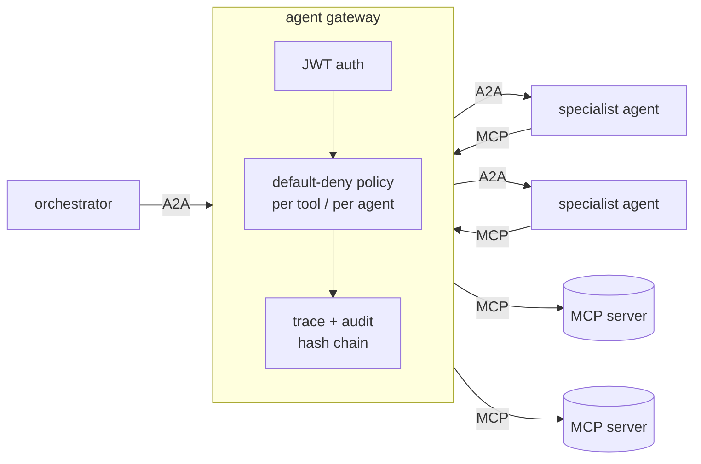

# agent-mesh-core

The shared core for three portfolio projects: an orchestrator that delegates to
specialist agents over **A2A**, agents that use tools exposed as **MCP**
servers, and one **agent gateway** that every call must pass through. The
gateway authenticates each agent, enforces which tools and agents it may use,
traces the call and writes a tamper-evident audit record.



Specialists call their tools *through the gateway* too, so no MCP or A2A request
skips auth, policy or audit.

## What the gateway enforces

| Control | How |
|---|---|
| Identity | HS256 JWT per agent (`sub` = principal), with `exp`, `jti`, issuer and audience all required. Agents only hold their own token, never the signing secret. |
| Least privilege | Default-deny policy in `mesh.yaml`: MCP grants per tool (fnmatch patterns), A2A grants per agent. `tools/list` responses are filtered, so agents never even see tools they can't call. |
| No bypass | The launcher gives every service a random upstream key that only the gateway presents. A direct request to a service gets a 403. |
| Credential isolation | The gateway strips the caller's token and adds the upstream's own headers (`${ENV}`-expanded from the host). Agents get a minimal environment, never the host's. |
| Protocol hygiene | Rejects `mcp-method`/`mcp-name` headers that disagree with the JSON-RPC body, binds MCP sessions to the principal that opened them, and disables A2A push-notification config, since it would let an agent make the server call arbitrary URLs. |
| Audit | Every request, allowed or denied, is appended to JSONL with the principal, tool, arguments, request/response SHA-256 and trace ID. Each record holds the previous record's hash; set `AGENTMESH_AUDIT_KEY` to HMAC the chain. Check it with `agentmesh audit verify`. |
| Tracing | OpenTelemetry spans for the gateway and for each agent, which continue the caller's `traceparent`, exported over OTLP/HTTP to Jaeger or Arize Phoenix. |
| Metrics | `GET /metrics` reports decision counts (e.g. blocked calls) and gateway overhead p50/p95/p99, separate from upstream time. |

## Layout

```
src/agentmesh/
  gateway.py    the gateway (Starlette reverse proxy)
  policy.py     default-deny policy
  auth.py       JWT issue/verify
  audit.py      hash-chained audit log + verify_chain
  a2a.py        build_agent_app(): an A2A v1.0 agent from an async function
  client.py     MeshClient: call_agent() / mcp() / call_tool() through the gateway; mcp_session() for any MCP URL
  serve.py      mcp_app(), the gateway-only guard, `python -m agentmesh.serve module:app`
  launcher.py   `agentmesh up`: one process per service + the gateway
  testing.py    LocalMesh: the whole mesh in-process on free ports, for tests
  tracing.py    OTel setup and propagation
  llm.py        optional Claude structured-output helper (off unless AGENTMESH_LLM=1)
examples/hello/ smallest mesh: MCP math server, a calculator agent, an orchestrator
```

## Quick start

```bash
uv venv -p 3.13 && uv pip install -e '.[dev]'
.venv/bin/pytest                      # 18 tests, including end-to-end over real sockets

cd examples/hello
export AGENTMESH_SECRET=$(python -c "import secrets; print(secrets.token_urlsafe(48))")
../../.venv/bin/agentmesh up mesh.yaml &       # math MCP :9101, calculator agent :9201, gateway :8000
../../.venv/bin/python call.py                 # {'result': 20.0, 'caller': 'orchestrator'}
../../.venv/bin/agentmesh audit verify audit/gateway.jsonl
curl -s localhost:8000/metrics
```

## Writing a mesh

```python
from agentmesh import AgentContext, MeshClient, Skill, build_agent_app

async def handle(payload: dict, ctx: AgentContext) -> dict:
    async with ctx.mesh.mcp("ecfr") as tools:          # via the gateway, as this agent
        part = await tools.call("get_part", title=40, part="60")
    return {"sections": len(part), "asked_by": ctx.caller}

def app(url="http://127.0.0.1:9201", mesh=None):
    return build_agent_app(name="retriever", description="...", url=url, handler=handle,
                           skills=[Skill("fetch", "Fetch", "...")], mesh=mesh or MeshClient.from_env())
```

Agent payloads travel as JSON text parts (`application/json`), not A2A data
parts, because data parts go through protobuf `Struct` and turn every integer
into a float. That matters when the integers are CIKs or dollar amounts.

## Versions this was built against

`a2a-sdk` 1.3 (A2A spec 1.0, `SendMessage`-style method names), `mcp` 2.3
(`MCPServer`, which replaced v1's `FastMCP`), Python 3.13.

## Why a custom gateway, and when to switch

Writing the gateway is the learning exercise, and it lets the Goldman project
put audit hashing inside the gateway. For production, the same `mesh.yaml`
concepts map onto [agentgateway](https://agentgateway.dev) (JWT, CEL-based RBAC
over MCP and A2A, OTel) or IBM ContextForge (see `../ibm-contextforge-legacy`).

## Known limits

- HS256 with one shared secret between the launcher and the gateway. Moving to RS256/EdDSA with a JWKS endpoint is a contained change in `auth.py`.
- A2A tasks aren't bound to principals, so one principal that knows another's task ID could `GetTask` it. The gateway does pass `x-agentmesh-principal` upstream for that check.
- JSON-RPC binding only (no A2A REST or gRPC through the gateway).
